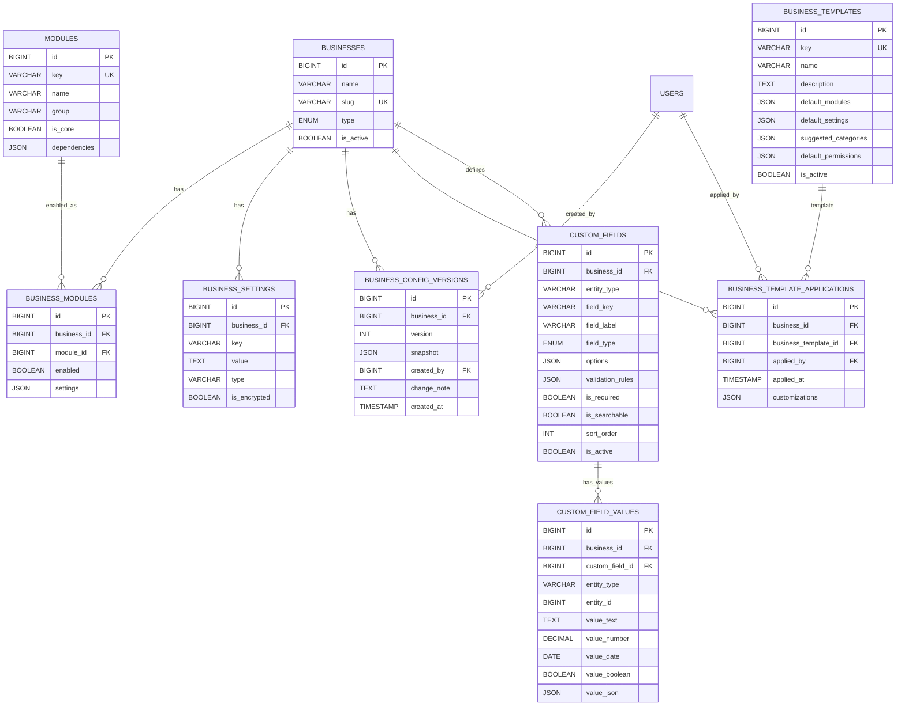
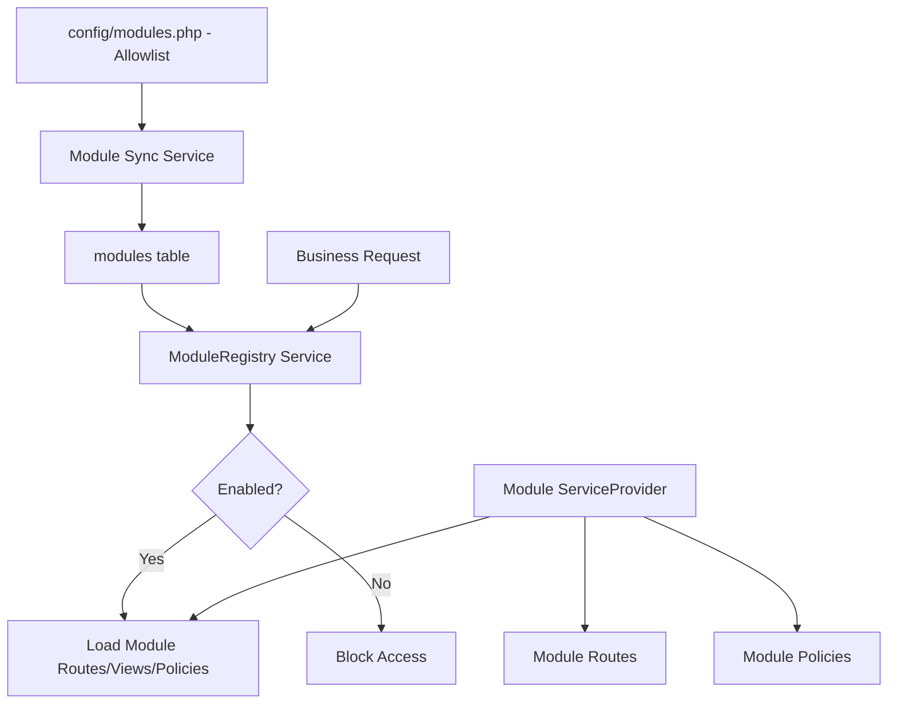
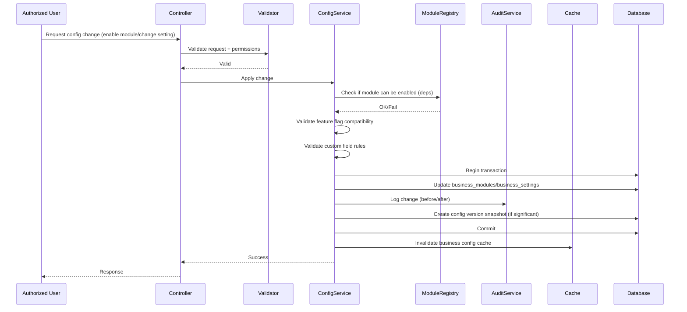

# Configurable ERP Engine Design

**Date:** 2026-10-29  
**Status:** Design for approval (no implementation yet - following instructions)  
**Base:** Approved Architecture, Database Schema, Authorization System

---

## 1) Configuration Data Model

### 1.1 Core Configuration Tables

Based on approved schema and requirements:

| Table | Purpose | Key Fields | Notes |
|---|---|---|---|
| `modules` | Global module registry (already designed) | `key`, `name`, `group`, `is_core`, `dependencies` (JSON), `description` | Source of truth for supported modules. Must only contain allowlisted modules. |
| `business_modules` | Per-business module enablement | `business_id`, `module_id`, `enabled`, `settings` (JSON) | Tracks which modules enabled per business with module-specific config. |
| `business_settings` | Business-specific feature flags/config | `business_id`, `key`, `value` (text), `type` (string/int/bool/json), `is_encrypted` | Generic key-value store for feature flags. |
| `business_config_versions` | Configuration versioning/audit | `business_id`, `version`, `snapshot` (JSON), `created_by`, `change_note` | Track config changes over time. |
| `business_templates` (new) | Business type templates | `key`, `name`, `description`, `default_modules` (JSON), `default_settings` (JSON), `suggested_categories` (JSON), `default_permissions` (JSON), `is_active` | Template definitions. |
| `business_template_applications` (new) | Track template application | `business_id`, `business_template_id`, `applied_by`, `applied_at`, `customizations` (JSON) | Audit trail of template usage. |

### 1.2 Custom Fields Tables (Refined)

From approved schema - EAV-lite approach:

| Table | Purpose | Key Fields | Notes |
|---|---|---|---|
| `custom_fields` | Field definitions per business/entity | `business_id`, `entity_type`, `field_key`, `field_label`, `field_type` (enum), `options` (JSON), `is_required`, `is_searchable`, `sort_order`, `is_active`, `validation_rules` (JSON) | Definitions. Validated server-side. |
| `custom_field_values` | Values stored with typed columns | `business_id`, `custom_field_id`, `entity_type`, `entity_id`, `value_text`, `value_number`, `value_date`, `value_boolean`, `value_json` | Typed storage for efficient querying. Never bypasses authorization. |

**Field types:** `text`, `textarea`, `number`, `decimal`, `date`, `boolean`, `select`, `multiselect` (only if justified with query needs).  
**Storage:** EAV-lite with typed columns is preferred over pure JSON per entity for queryability. Dynamic column addition is **not permitted**.  
**Validation:** Stored in `validation_rules` JSON, enforced by Form Requests/validation layer.  
**Authorization:** Custom field access is checked via parent entity policies - custom fields never grant bypass of business isolation.  

### 1.3 Configuration Data Model Diagram



---


## 2) Module Registry Design

### 2.1 Registry Structure

The module registry must be backend-only, allowlist-based, and not allow arbitrary PHP execution.

**Location:** `config/modules.php` (static allowlist) + database `modules` table (registered modules) + runtime registry service.

```php
// config/modules.php structure
return [
    'registry' => [
        'products' => [
            'key' => 'products',
            'name' => 'Products and Services',
            'group' => 'catalog',
            'is_core' => true,
            'dependencies' => [],
            'provider' => \App\Modules\Catalog\Products\ProductsServiceProvider::class,
            'permissions' => ['products.view', 'products.create', 'products.update', 'products.delete'],
            'features' => ['track_stock', 'variants'], // features this module can provide
        ],
        // ...
    ],
];
```

### 2.2 Module Registry Service

**Class:** `App\Services\ModuleRegistry\ModuleRegistry`

Responsibilities:
- Load allowlisted modules from config
- Sync with database `modules` table
- Check if module is enabled for a business (`business_modules.enabled = true`)
- Check dependencies are satisfied
- Validate module can be enabled/disabled based on dependencies and business state
- Prevent enabling arbitrary classes
- Provide feature flags based on enabled modules
- Cache results per business (with invalidation on changes)

```php
interface ModuleRegistryContract {
    public function getAll(): Collection;
    public function getEnabled(Business $business): Collection;
    public function isEnabled(Business $business, string $key): bool;
    public function canEnable(Business $business, string $key): bool;
    public function enable(Business $business, string $key, array $settings = []): void;
    public function disable(Business $business, string $key): void;
    public function getDependencies(string $key): array;
    public function validateDependencies(Business $business, string $key): bool;
}
```

### 2.3 Module Registration Mechanism

New modules added via:
1. **Config allowlist** - Add to `config/modules.php` with class references (must exist and be autoloadable)
2. **Service Provider** - Module creates its own ServiceProvider in `app/Modules/{Module}/` and registers routes/views/policies/events
3. **ModuleServiceProvider** - Central registrar discovers and loads enabled modules only
4. **Database registration** - Seeder/sync populates `modules` table from allowlist

**Security:** Only classes defined in allowlist can be registered. No dynamic `eval()`, no uploaded code execution. 



### 2.4 Adding Future Modules (Developer Guide)

To add a new module without modifying unrelated modules:
1. Create module directory: `app/Modules/{Group}/{ModuleName}/`
2. Create ServiceProvider: `{ModuleName}ServiceProvider` with `register()` and `boot()`
3. Add to allowlist in `config/modules.php` with provider class, dependencies, permissions
4. Add migrations in module directory (loaded by ModuleServiceProvider)
5. Add routes in `Routes/web.php` under module namespace
6. Add policies, services, controllers
7. Run module sync to populate database
8. Module will only load if enabled for business via registry

**No changes to core routing, no cross-module edits required.** Dependencies are declared explicitly.

---


## 3) Configuration Lifecycle

### 3.1 Lifecycle Stages



### 3.2 Validation Rules

**Configuration changes must validate:**
- **Authorization:** User has permission (e.g., `business.config.manage`, `roles.manage`)
- **Module dependencies:** If enabling module A requires module B, both must be enabled or enable B first
- **Incompatible flags:** e.g., `expiry_tracking` requires batch tracking capability; if product doesn't support batches, flag invalid
- **Business type compatibility:** Templates don't restrict, but some flags may conflict
- **Custom fields:** Field definitions validated (types, options for select/multiselect, validation rules)
- **Isolation:** No cross-business config changes possible
- **Allowlist:** Only supported modules/settings can be changed

**Validation Service:** `App\Services\Config\ConfigValidator`

```php
interface ConfigValidatorContract {
    public function validateModuleToggle(Business $business, string $moduleKey, bool $enabled): array; // returns errors
    public function validateFeatureFlag(Business $business, string $key, mixed $value): array;
    public function validateCustomField(Business $business, array $data): array;
    public function checkIncompatible(array $settings): array;
}
```

### 3.3 Authorization for Config Changes
- **Business config:** Requires `business.config.manage` permission
- **Module activation:** Requires `business.config.manage`
- **Feature flags:** Requires appropriate permission (some flags may need higher privileges)
- **Custom fields:** Requires permission to manage that entity's custom fields
- **Templates:** Applying template requires `business.config.manage` and is audited
- **Platform config:** Separate platform permissions only

All enforced via Policies/Middleware - backend authoritative.

### 3.4 Audit Logging
Every config change logged to `audit_logs`:
- `event`: `config.module.toggled`, `config.setting.updated`, `config.custom_field.created`, `config.template.applied`
- `auditable_type`: `BusinessModule` or `BusinessSetting` or `CustomField`
- `old_values` / `new_values` (JSON)
- `business_id`, `user_id`, `ip_address`, `user_agent`

### 3.5 Safe Defaults
- Core modules enabled by default for new businesses
- Sensible defaults per business type template
- `track_inventory` defaults based on business type (grocery true, service-only may be false)
- Negative stock disabled by default
- Expiry/serial tracking disabled by default
- All features opt-in via modules/flags

### 3.6 Cache Invalidation
Config cached per business: `business.config.{business_id}` 
Invalidate on:
- Module toggled
- Setting updated
- Template applied
- Custom field changed
- Cache tags if using Redis

Use `Cache::tags(['business:'.$business->id, 'config'])->flush()` or specific keys.

### 3.7 Configuration Versioning
- On significant changes (template application, bulk module changes), create `business_config_versions` snapshot
- Snapshot includes enabled modules, key settings, custom fields summary
- Allows rollback capability (future) and audit trail
- Version auto-incremented per business

---


## 4) Example Configurations

### 4.1 Grocery Store Configuration

**Business Template:** `grocery`

**Default Modules:**
```json
[
  "products", "categories", "inventory", "purchasing", "customers", "suppliers",
  "sales_pos", "expenses", "reporting", "batch_expiry", "barcode"
]
```

**Default Settings (business_settings):**
```json
{
  "track_stock": {"value": "true", "type": "bool"},
  "allow_negative_stock": {"value": "false", "type": "bool"},
  "track_expiry_dates": {"value": "true", "type": "bool"},
  "require_serial_numbers": {"value": "false", "type": "bool"},
  "enable_discounts": {"value": "true", "type": "bool"},
  "enable_partial_payments": {"value": "true", "type": "bool"},
  "require_customer_details_for_sales": {"value": "false", "type": "bool"},
  "enable_repair_workflows": {"value": "false", "type": "bool"},
  "use_fefo_for_expiry": {"value": "true", "type": "bool"},
  "default_warehouse_required": {"value": "true", "type": "bool"}
}
```

**Suggested Categories:**
```json
["Fruits & Vegetables", "Dairy & Eggs", "Meat & Seafood", "Bakery", "Beverages", "Snacks", "Household", "Personal Care"]
```

**Relevant Workflows:** Purchase with batch/expiry, POS with batch selection (FEFO), expiry alerts, stock tracking

**Custom Fields (examples):** Product - `brand` (text), `country_of_origin` (text). Batch-related handled by module.

### 4.2 Repair Center Configuration

**Business Template:** `repair_center`

**Default Modules:**
```json
[
  "products", "customers", "suppliers", "inventory", "purchasing", "sales_pos",
  "repairs", "repair_work_orders", "expenses", "reporting", "warranty"
]
```

**Default Settings:**
```json
{
  "track_stock": {"value": "true", "type": "bool"},
  "allow_negative_stock": {"value": "false", "type": "bool"},
  "track_expiry_dates": {"value": "false", "type": "bool"},
  "require_serial_numbers": {"value": "false", "type": "bool"},
  "enable_discounts": {"value": "true", "type": "bool"},
  "enable_partial_payments": {"value": "true", "type": "bool"},
  "require_customer_details_for_sales": {"value": "true", "type": "bool"},
  "enable_repair_workflows": {"value": "true", "type": "bool"},
  "track_spare_parts": {"value": "true", "type": "bool"},
  "require_device_details": {"value": "true", "type": "bool"},
  "generate_repair_invoice": {"value": "true", "type": "bool"}
}
```

**Suggested Categories:**
```json
["Spare Parts", "Accessories", "Services", "Tools"]
```

**Relevant Workflows:** Repair intake (customer + device), diagnosis, assign technician, consume spare parts from inventory, labor charges, repair invoice, warranty

**Custom Fields (examples):** Repair Job - `device_password` (text, encrypted consideration), `accessories_left` (textarea). Customer Device - `imei` (text), `serial_number` (text).

**Note:** `device_password` would need careful handling (encryption) - flagged for security review.

---


## 5) UI Adaptation Strategy

### 5.1 Backend-Driven Navigation
- Navigation built from enabled modules + user permissions
- `MenuService` builds menu structure based on `ModuleRegistry::getEnabled($business)` and `RbacService::userCan()`
- Modules can register menu items via their ServiceProvider
- Hiding in Blade is **not** authorization - routes protected by middleware

### 5.2 Configuration UI
- Only show config options for enabled modules
- Only users with `business.config.manage` see config section
- Feature flags shown based on module availability
- Incompatible combinations disabled with explanation
- Custom field manager only for entities with permission

### 5.3 Backend Enforcement (Critical)
- All routes use `EnsureModuleEnabled` middleware
- All actions use Policies
- Config endpoints check permissions
- Frontend is for UX only - backend is authoritative

---


## 6) Extensibility Guide

### Adding a New Module

**Step 1:** Create module structure
```
app/Modules/Finance/Accounting/
├── AccountingServiceProvider.php
├── Routes/web.php
├── Http/Controllers/
├── Policies/
├── Services/
├── Models/
└── Migrations/
```

**Step 2:** Register in allowlist
```php
// config/modules.php
'accounting' => [
    'key' => 'accounting',
    'name' => 'Accounting Integration',
    'group' => 'finance',
    'is_core' => false,
    'dependencies' => ['expenses'], // example
    'provider' => \App\Modules\Finance\Accounting\AccountingServiceProvider::class,
    'permissions' => ['accounting.view', 'accounting.sync'],
],
```

**Step 3:** Create ServiceProvider
```php
class AccountingServiceProvider extends ServiceProvider {
    public function register() { /* bind services */ }
    public function boot() {
        $this->loadRoutesFrom(__DIR__.'/Routes/web.php');
        $this->loadViewsFrom(__DIR__.'/Resources/views', 'accounting');
        $this->loadMigrationsFrom(__DIR__.'/Migrations');
        // Register policies
    }
}
```

**Step 4:** Register with ModuleServiceProvider (discovers enabled modules)

**Step 5:** No changes to core modules needed - use contracts/interfaces, events for integration

**Rules:**
- Must be in allowlist (no dynamic loading of arbitrary classes)
- Declare dependencies explicitly
- Use contracts for integration points
- Listen to events rather than modifying core
- Module can only be enabled if dependencies satisfied
- All routes protected by business context + permissions

---


## 7) Implementation Plan (Incremental)

Following "Then implement the approved design incrementally":

### Phase 1: Core Configuration Infrastructure
1. Create migrations for `business_templates`, `business_template_applications`, update `custom_fields` with `validation_rules`
2. Create models: `BusinessTemplate`, `BusinessTemplateApplication`, update existing models
3. Create `ModuleRegistry` service and contract
4. Create `ConfigService`, `ConfigValidator`
5. Create middleware: `EnsureModuleEnabled`, update business middleware stack
6. Create policies for config operations
7. Seed module registry and business templates

### Phase 2: Business Templates & Module Management
1. Template application logic
2. Module enable/disable UI/backend
3. Feature flags system
4. Validation for incompatible combinations
5. Audit logging for config changes
6. Cache invalidation

### Phase 3: Custom Fields
1. Custom field CRUD
2. Validation rules engine
3. EAV-lite storage/retrieval
4. Integration with forms/views
5. Authorization checks

### Phase 4: UI Integration & Tests
1. Module-aware navigation
2. Config UI
3. Automated tests for config validation, permissions, business isolation
4. Example configs for grocery and repair center

**Note:** Will start implementation after this design is reviewed/approved per instructions.

---


## Summary

- **Configuration Model:** Tables for modules, settings, templates, versions, custom fields (EAV-lite)
- **Module Registry:** Allowlist-based, dependency-aware, no arbitrary code execution
- **Lifecycle:** Validate -> authorize -> apply in transaction -> audit -> version -> invalidate cache
- **Templates:** Provide sensible defaults without restricting flexibility
- **Extensibility:** New modules added via allowlist + ServiceProvider, no core modifications
- **Security:** Backend authoritative, all changes authorized/audited, isolation enforced
- **Examples:** Grocery and repair center configurations provided

Ready for review.